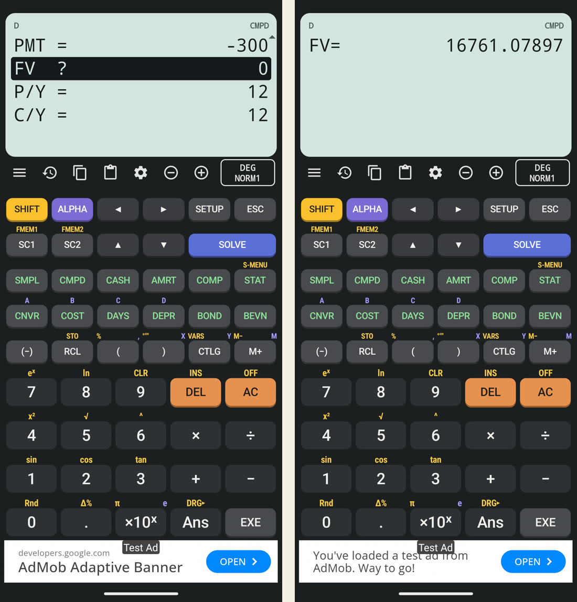
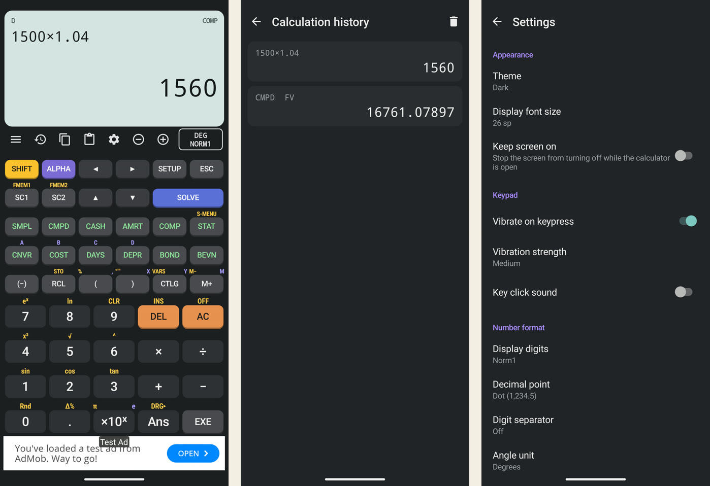
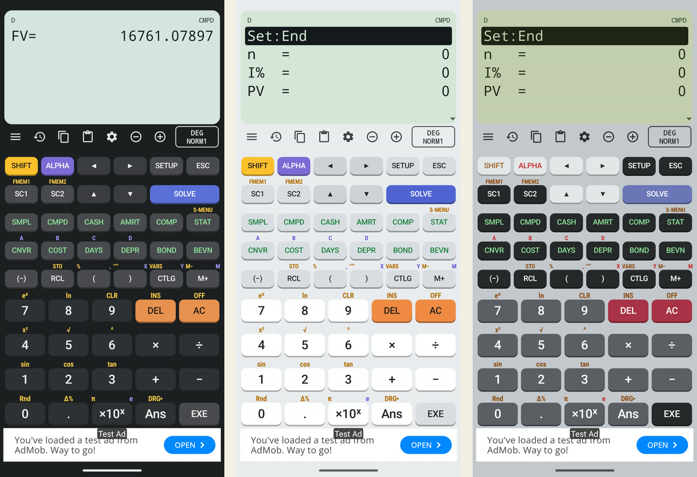

This is the first entry for this project. It is a software build, not a hardware one: no bench, but the same approach of testing every result against a reference.

Contents

* TOC
{:toc}

## Why build it

31 October 2026

**Objective.** GE 348 (Engineering Economics) exams allow the CASIO FC-200V financial calculator. I ordered one online, but the delivery date was the night before the midterm, which left no time to learn its key sequences. I needed an alternative that works like the real calculator, to practise on until it arrived.

**Method.** Build an Android app that copies the FC-200V's modes, keys and display rules, using the official CASIO manual (the FC-200V/FC-100V user's guide, a PDF found online) as the specification. All code was written through Claude Code, Anthropic's command-line coding agent, running on my laptop with the Android SDK, Gradle and an Android emulator.

**Conclusion.** The goal was practice fidelity, not a new calculator: a solve on the app must give the same number, in the same display format, as the manual shows.

> **Update, 1 November 2026:** Before publishing, the app was renamed FinCalc200, its keypad was rearranged and the classic CASIO theme was replaced, so it no longer copies the calculator's name, layout or colours. See [Part 2](/fc200v-emulator/part-2-its-own-name-keypad-and-look/).

## First version and the CalcES study

31 October 2026

**First version.** The first build was a WebView wrapper: an Android Gradle project (Gradle 8.11.1, Android Gradle Plugin 8.7.3, JDK 21) that loaded a web version of the calculator. It worked, but it scrolled, zoomed and reacted to taps like a web page, which is not how a calculator should feel.

**Look and feel.** For the visual design I used CalcES, an existing calculator app, as a reference. Its assets are encrypted, so nothing was copied from the package. Instead it was installed on the Android emulator and screenshotted with `adb` (Android's debugging tool), and the layout, key colours and display style were reproduced from the screenshots.

**Extras.** Claude Code offered feature sets as a multiple-choice question; I chose the everyday set: calculation history, themes (dark, light, follow system, and a classic CASIO palette), display font size, key vibration and sound, FIX/SCI/NORM display, decimal and thousands separators, copy and paste, and keep-screen-on.

## Native rebuild from the manual

31 October to 1 November 2026

The WebView version was replaced with a native app in plain Java: custom-drawn views for the LCD and the keys, with no web content and no UI framework beyond the Android SDK. The release APK is 427 KB.

The manual was read page by page and each rule became code:

| Manual section | Implemented as |
|---|---|
| Calculation priority sequence | Expression evaluator; implied multiplication ranks with × and ÷, `%` divides by 100 |
| SMPL, CMPD (time value of money) | Solvers for n, I%, PV, PMT and FV; root finding by grid scan plus the Illinois method |
| CASH, AMRT, CNVR, COST, DAYS, DEPR, BOND, BEVN | One function group per mode; DAYS and BOND use the 360-day rule from the manual |
| STAT | Data editor (shared with CASH) and the regression types |
| SETUP, STO / RCL / CLR, SC1 / SC2, FMEM1 / FMEM2 | Menus and memory as the manual describes; state saved between launches |

Two details the manual states but are easy to get wrong:

- **360-day rule.** A start date on the 31st becomes the 30th; an end date on the 31st becomes the 1st of the next month.
- **Sum-of-years' digits.** The last year uses the (12 − YR1)/12 factor.

Repetitive XML (launcher icon, manifest, styles) was generated by small Node.js scripts. The Gradle build folder was moved out of OneDrive, because OneDrive sync locked files in it mid-build and the build failed with access-denied errors.

*The manual's compound interest example in CMPD mode: n = 48, I% = 4, PV = −1000, PMT = −300, P/Y = C/Y = 12. Left: the inputs with FV selected. Right: SOLVE gives FV = 16761.07897.*
{: .caption}

## Testing against the manual

1 November 2026

**Method.** Two layers. JUnit tests run the engine on the manual's worked examples, some through simulated key presses. Then the built APK was installed on the Android emulator and a script pressed the on-screen keys through `adb` and saved a screenshot after each sequence, so the display could be compared with the manual.

**Result.** 17 JUnit tests, all passing. A selection:

| Example | Reference | App | Verdict |
|---|---|---|---|
| CMPD: FV of n = 48, I% = 4, PV = −1000, PMT = −300, monthly | Manual: ≈ $16,760 (rounded in the text) | 16761.07897 | Match; the manual rounds the printed answer |
| BOND: price | Manual: −97.6151555 | −97.6151555 | Match |
| STAT: σx of the manual's data | Manual: 2 | 2 | Match |
| Loan PMT: $100,000, 6%, 360 months | Annuity formula: −599.5505252 | −599.5505252 | Match |

The CMPD test first failed against the manual's printed $16,760. The app's 16761.07897 was correct; the manual rounds the answer in its text, so the test was changed to the exact value.

The emulator run found two faults the unit tests could not: the app crashed at launch (it asked the window for its insets controller before the window's decor view existed), and the badge on the display that shows the angle unit and display mode was invisible. Both were fixed and rechecked on the emulator.

*Everyday extras. Left: a COMP calculation. Centre: the history, which keeps COMP and solved results. Right: settings for theme, font size, vibration, display digits and separators.*
{: .caption}

*Dark, light and classic CASIO themes. The classic palette copies the physical calculator's grey body and dark keys.*
{: .caption}

> **Update, 1 November 2026:** The classic palette was replaced by a Retro theme and the keys were rearranged. See [Part 2](/fc200v-emulator/part-2-its-own-name-keypad-and-look/#a-rearranged-keypad).

**Conclusion.** The emulator reproduces the manual's examples exactly, and the display matches the manual's format. What this does not show: it was tested against the manual, not side by side with a physical FC-200V, which had not arrived. The comparison with the real calculator is still to do.

**Next:** [Part 1](/fc200v-emulator/part-1-fee-goal-ads-and-billing/), getting it ready to publish on Google Play.
