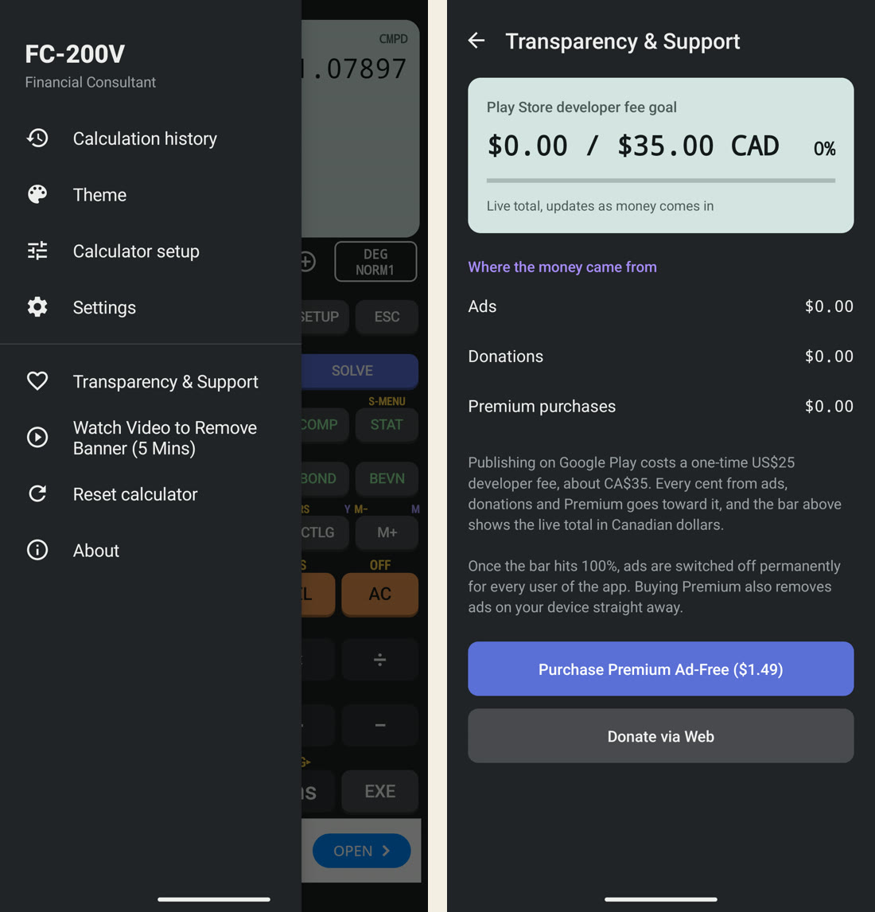
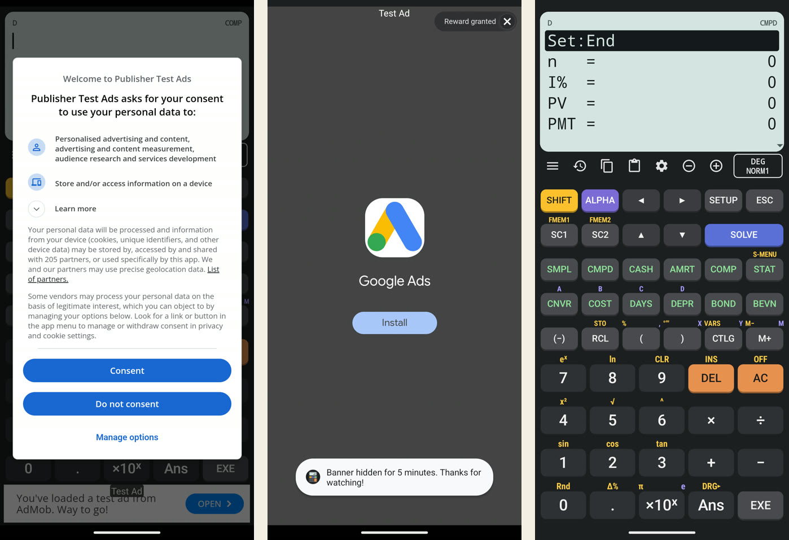

This entry continues from [Part 0](/fc200v-emulator/part-0-why-and-the-native-rebuild/), which ended with the emulator matching the manual's examples. The next step was publishing it on Google Play, which needs a developer account with a one-time fee.

Contents

* TOC
{:toc}

## The fee goal

1 November 2026

**Objective.** Google Play charges US$25 (about CA$35) once to register as a developer. I wanted the app to earn back exactly that and then become ad-free for every user, and to show users the running total so they can see the promise is real.

**Design.**

- A single Firestore document, `app_metrics/revenue_goal`, holds three numbers in CAD: `ads_earned`, `donations_earned` and `premium_earned`.
- A "Transparency & Support" screen shows the total against CA$35.00, the percentage and the three sources, live.
- When the total reaches CA$35.00, ads switch off permanently on every device.
- Three ways to contribute: ads (a banner, plus an optional rewarded video), a PayPal donation link, and a CA$1.49 Premium purchase that removes ads on the buyer's device at once.

The goal was first set at US$25 and $0.99 for Premium, then changed to CA$35 and CA$1.49 the same day, so every amount in the app and the database is in one currency.

*Left: the side menu with the two new items. Right: the Transparency & Support screen reading the live Firestore document, at $0.00 / $35.00 CAD before launch.*
{: .caption}

## Console work outside Claude Code

1 November 2026

Claude Code works on files and commands on my laptop. It cannot click through web consoles, accept agreements or verify my identity, so I did that part myself with step-by-step guidance from a separate Gemini chat:

| Step | Where | Notes |
|---|---|---|
| Create the Firebase project and register the Android app | Firebase console | The package name entered there, `com.finance.calculator`, became the app's permanent store ID |
| Create the Firestore database and the `revenue_goal` document | Firebase console | Three `double` fields set to 0. The console calls the type "double", not "number" |
| Register as a Google Play developer and pay the fee | Play Console | Identity verification is manual and takes days |
| Create the app and its banner and rewarded ad units | AdMob | The account showed identity verification in progress |
| Create a PayPal.Me link | PayPal | Used by the Donate button |

The prompts Claude Code received were drafted in that chat and pasted in, with the real IDs filled in.

> **Lesson:** The package name typed into Firebase did not match the one in the code (`com.saroj.fc200v`), and the build refuses to run when they differ. The fix was to change only the application ID and keep the Java package, so no source files moved. The cost: the new build installs as a different app from the Part 0 APK, so settings and history do not carry over.
>
> **Update, 1 November 2026:** The Java package was later renamed to `com.saroj.fincalc` to drop the model name. See [Part 2](/fc200v-emulator/part-2-its-own-name-keypad-and-look/#name-and-brand-references).

## Firestore goal and master ad switch

1 November 2026

**Method.** One shared real-time listener on the document feeds both the Transparency screen and a master switch. The switch is a one-way latch saved on the device: once the goal is reached, or Premium is owned, ads stay off even offline and after a restart.

The goal is compared in whole cents, not as a raw floating-point sum. Adding 1.49 repeatedly in binary floating point can land just under 35.00, which would leave ads on after the goal was met. Two new unit tests cover this, bringing the total to 19.

Security rules allow anyone to read the document, and allow the app only one kind of write: adding exactly 1.49 to `premium_earned`. Ads and donations are entered by hand in the console.

> **Note:** The app's Firebase key is public by design, so someone could repeat that one allowed write and push the bar to 100% without paying. The rules limit the damage to that one field, and it can be reset by hand. Verifying each purchase on a server is the stronger fix and is not built.

## Banner and the rewarded break

1 November 2026

**Method.** An adaptive AdMob banner sits in a slot under the keypad that takes no space when empty. A side-menu item plays a rewarded video; watching it to the end hides the banner for 5 minutes. The expiry time is saved, the banner is destroyed during the break so it makes no requests, and the time is rechecked whenever the app returns to the foreground.

Debug builds always use Google's test ad units; only release builds use the real ones, because tapping your own live ads can get an AdMob account suspended.

**Result,** on the Android emulator with test ads:

| Check | Expected | Observed | Verdict |
|---|---|---|---|
| Banner after launch | Test banner under the keypad | Shown | Pass |
| Watch the video to the end | Banner removed, expiry saved | Removed; expiry saved 5 min after the reward | Pass |
| Leave the app, return after expiry | Banner back | Back on return | Pass |

*Left: Google's consent form as an EU user sees it (test configuration). Centre: a rewarded test video after the reward is granted, with the app's confirmation message. Right: the calculator straight afterwards, with the banner gone for 5 minutes.*
{: .caption}

The AdMob SDK first used (23.6.0) logged that it was out of date, so it was moved to 25.5.0. That version makes the Android build's lint step print Kotlin version errors; the build still succeeds and the errors go away with a newer Android Gradle Plugin.

## Consent and Play Billing

1 November 2026

**Consent.** Users in the EU and UK must be asked for consent before ads are personalised. The app now asks Google's consent service first and starts AdMob only after consent is settled, and adds an "Ad privacy options" item to the menu where the law requires one. Tested by forcing an EU location on the emulator with Google's sample app ID:

| Check | Observed |
|---|---|
| First launch | Consent form shown; no ad requested behind it |
| Consent | Banner loads |
| Ad privacy options, then Do not consent | Choices stored as all refused; limited, non-personalised ads continue, as Google designs it |

With my real app ID, the consent service replies that no consent message is configured, because I have not yet created one in AdMob. Outside the EU and UK ads still load. EU and UK users would see none until the message exists.

**Play Billing.** The Premium button opens Google Play's purchase sheet for a one-time product, `premium_ad_free`. After a purchase, the app confirms it with Google Play, unlocks Premium on the device and adds 1.49 to `premium_earned`. On every launch the app asks Google Play what the account already owns, so a reinstall or a second phone gets Premium back automatically, without being counted toward the goal a second time. A purchase cannot be tested on the emulator: there is no Play account on it, and Play only sells products for apps uploaded to the Play Console. The app reports that Play is unavailable and carries on.

A web donation of CA$1.49 or more unlocking Premium was considered, using emailed codes. It was dropped because codes can be shared and I did not want to answer emails by hand; Play Billing restores purchases with no manual step.

## Where it stopped

1 November 2026

The code is complete for a first release, and the debug and release builds compile with all 19 tests passing. Publishing stopped here: Google is verifying my Play developer, AdMob and payments accounts, which takes a few days, and nothing can be uploaded or sold until that clears.

| Remaining step | Blocked by |
|---|---|
| Publish an EU consent message in AdMob | AdMob verification |
| Paste the security rules into Firebase | Nothing; quick |
| Create a release signing key and build an app bundle | Nothing; the current release uses a debug key, which Play rejects |
| Upload to an internal testing track, create the CA$1.49 product | Play verification |
| Store listing, privacy policy, Data safety form, `app-ads.txt` | Play verification |
| Test a real purchase, then a restore on a second phone | Internal testing track |
| Compare the app with the physical FC-200V | The calculator arriving |

**Next:** finish the launch steps above once Google verifies the accounts.

> **Update, 1 November 2026:** First, the app was given its own name, keypad and theme. See [Part 2](/fc200v-emulator/part-2-its-own-name-keypad-and-look/).
