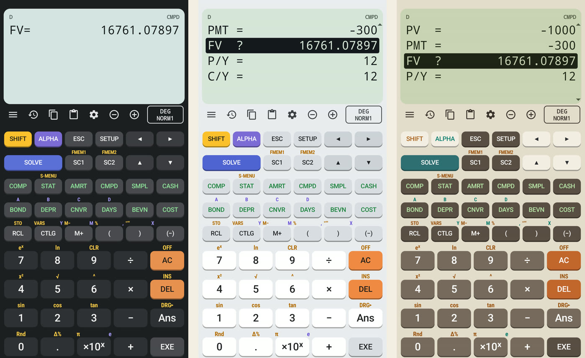

This entry continues from [Part 1](/fc200v-emulator/part-1-fee-goal-ads-and-billing/), which ended with the Play version code-complete and waiting on Google's account verification.

Contents

* TOC
{:toc}

## Why it changed

1 November 2026

**Objective.** The app started as a stand-in for the CASIO FC-200V, something to practise on until the real calculator arrived. A public Play Store app is a different thing: it should stand on its own and not present itself as, or look like a copy of, another company's product.

**Method.** I reviewed the app against Google Play's impersonation and intellectual property policies before uploading anything. Three things stood out:

| Item | State after Part 1 | Concern |
|---|---|---|
| Name | Launcher name, side menu and About title "FC-200V"; About text "a native Android version of the Casio FC-200V" | A trademark in the app name and text, which Play's automated checks flag as impersonation |
| Keypad | Same keys in the same positions as the physical calculator | A one-to-one copy of a product's layout is what a trade dress claim rests on |
| Classic theme | Named "Classic CASIO", copying the calculator's grey body and dark keys | Brand name plus the product's look |

A takedown or a policy strike lands on the developer account, not only the app, so these were fixed before the first upload rather than after a complaint.

**Conclusion.** Keep the calculations, which were written from the manual's published formulas, and change everything that identifies the app with the physical calculator: name, text, layout and colours. This is my own review of the policies, not legal advice.

## Name and brand references

1 November 2026

**Method.** Searched the source and resources for the brand and model name, then changed every place a user, the Play Store or an APK scan can see:

| Where | Before | After |
|---|---|---|
| Launcher and menu title | FC-200V | FinCalc200 |
| Menu subtitle | Financial Consultant | Financial calculator |
| About text | "A native Android version of the Casio FC-200V financial calculator" | "A standalone financial calculator for Android", plus "An independent app, written from scratch. Not affiliated with or endorsed by any calculator manufacturer." |
| Clipboard label | FC-200V | FinCalc200 |
| Theme name | Classic CASIO | Retro |
| Java package (visible in the APK) | `com.saroj.fc200v` | `com.saroj.fincalc` |
| Saved settings file, Gradle project, build folder | `fc200v` | `fincalc`, `FinCalc200` |

The store ID, `com.finance.calculator`, was already neutral and did not change. The mode names (CMPD, AMRT, BOND and the rest) stay: they describe the calculations the app performs. Source comments still cite the FC-200V/FC-100V user's guide by page, because that manual is the specification the formulas were written from.

> **Note:** Renaming the package and the settings file means data saved by earlier test builds does not carry over. Nothing has been published yet, so no user loses anything.

## A rearranged keypad

1 November 2026

**Method.** The keypad is defined as one table in the code, so it was rearranged there. Every row changed except the digits:

| Row | Part 1 (as on the calculator) | Part 2 |
|---|---|---|
| 1 | SHIFT, ALPHA, ◀, ▶, SETUP, ESC | SHIFT, ALPHA, ESC, SETUP, ◀, ▶ |
| 2 | SC1, SC2, ▲, ▼, SOLVE | SOLVE, SC1, SC2, ▲, ▼ |
| 3 | SMPL, CMPD, CASH, AMRT, COMP, STAT | COMP, STAT, AMRT, CMPD, SMPL, CASH |
| 4 | CNVR, COST, DAYS, DEPR, BOND, BEVN | BOND, DEPR, CNVR, DAYS, BEVN, COST |
| 5 | (−), RCL, (, ), CTLG, M+ | RCL, CTLG, M+, (, ), (−) |
| 6–9 | DEL and AC beside 7, 8, 9; × ÷, + −, Ans in pairs | ÷ × − + in one column, as on a phone calculator; AC, DEL and Ans in the right column |

The arrows now sit together on the right, the general modes (COMP, STAT) come before the money modes, and the operators read top to bottom.

The ALPHA letters A to D are printed above four keys in row 4. Moving those keys would have scattered the letters, so the letter map in the calculator engine was changed to follow position instead: A is now on BOND, B on DEPR, C on CNVR and D on DAYS, still left to right.

*The new keypad in the dark, light and Retro themes, all showing the manual's CMPD example solved for FV = 16761.07897. Compare the old arrangement in [Part 0](/fc200v-emulator/part-0-why-and-the-native-rebuild/#testing-against-the-manual).*
{: .caption}

> **Lesson:** The cost of a different layout is practice transfer. The key sequences are unchanged (CMPD, enter values, select FV, SOLVE), but the keys are no longer where they are on the physical calculator, so finger positions learnt on the app do not carry over one to one.

## Retro theme and checks

1 November 2026

**Method.** The "Classic CASIO" palette was replaced by "Retro": a warm beige body, brown keys, teal SOLVE and ALPHA accents and an orange AC, around the same plain green LCD. Its internal ID stayed the same, so a saved theme choice still loads. Then the 19 unit tests were rerun and the debug build was checked on the Android emulator with the `adb` key script from [Part 0](/fc200v-emulator/part-0-why-and-the-native-rebuild/#testing-against-the-manual).

**Result.**

| Check | Expected | Observed | Verdict |
|---|---|---|---|
| JUnit tests | 19 pass | 19 pass | Pass |
| Manual's CMPD example: n = 48, I% = 4, PV = −1000, PMT = −300, P/Y = C/Y = 12 | FV = 16761.07897 | 16761.07897 | Pass |
| 5, SHIFT RCL (STO), BOND: store in A | STO menu, A selected | STO menu opened with A selected | Pass |
| ALPHA BOND + 1 EXE | A+1 = 6 | 6 | Pass |
| Theme menu, Retro | New palette | Beige and brown, readable labels | Pass |
| Side menu and About | FinCalc200, no brand names | As written above | Pass |

**Conclusion.** The app now has its own name, layout and look, and still reproduces the manual's results. What this does not show: how Google Play's review treats it, which is only known after the first upload, and whether the remaining similarities (mode names, the green LCD) raise any issue. The comparison with the physical calculator is also still to do.

**Next:** finish the launch steps from [Part 1](/fc200v-emulator/part-1-fee-goal-ads-and-billing/#where-it-stopped) once Google verifies the accounts.
