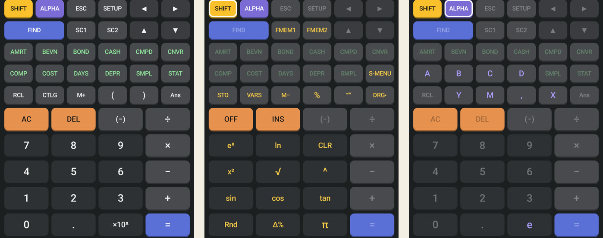
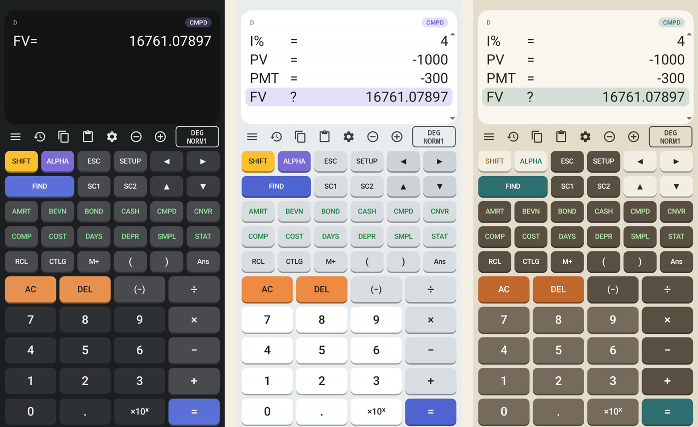

This entry continues from [Part 2](/fc200v-emulator/part-2-its-own-name-keypad-and-look/), which renamed the app and rearranged the keypad, but left three things that still followed the physical calculator: the mode keys in a hardware-style grid, two or three labels printed on each key, and an LCD-style display.

Contents

* TOC
{:toc}

## Mode keys and the number pad

1 November 2026

**Objective.** Arrange the keys by a rule a phone user would recognise, not by any calculator's hardware.

**Method.** Two changes to the key table:

- **Mode keys in alphabetical order.** The twelve mode keys now read AMRT, BEVN, BOND, CASH, CMPD, CNVR on the first row and COMP, COST, DAYS, DEPR, SMPL, STAT on the second.
- **Phone-style number pad.** Four columns, as on a phone calculator: AC, DEL, (−), ÷ on top, then 7 8 9 ×, 4 5 6 −, 1 2 3 + and 0 . ×10ˣ =. The four operators sit in the far-right column with = at the bottom right. Ans moved up to the row with RCL, CTLG, M+ and the brackets.

Two keys were also relabelled for a general audience: EXE became **=** and SOLVE became **FIND**. Only the labels changed; the calculator engine still receives the same key codes, so its behaviour and the tests are untouched.

The ALPHA letters A to D follow position again, as in Part 2: they are now on COMP, COST, DAYS and DEPR.

## One label per key

1 November 2026

**Objective.** A physical calculator prints two or three functions on each key because keys are expensive. A touch screen has no such limit, and the printed labels made the keypad cluttered and calculator-like.

**Method.** The small labels above each key were removed. Each key now draws one label, and the keypad redraws whenever SHIFT or ALPHA changes state:

| State | Label shown | Keys with no function in that state |
|---|---|---|
| Normal | Main function | None |
| SHIFT on | Shift function in yellow: STO, VARS, eˣ, ln, sin, π and the rest | Dimmed |
| ALPHA on | Letter or symbol in purple: A to D, X, Y, M, the comma and e | Dimmed |

Dimming is not cosmetic. The engine ignores a key with no second function while SHIFT or ALPHA is on, so a dimmed key is one that would do nothing. On the orange AC and DEL keys the shift labels (OFF, INS) keep the key's normal text colour, because yellow did not read on orange.

*Left: normal. Centre: after SHIFT, keys show STO, eˣ, sin and the rest, and keys without a shift function are dimmed. Right: after ALPHA, the letters A to D appear on COMP, COST, DAYS and DEPR.*
{: .caption}

## A display, not an LCD

1 November 2026

**Objective.** The display still imitated a calculator LCD: a mint or green panel, a monospaced font and black inverse bars for the selected row.

**Method.** The display view was rewritten:

| Element | Before | After |
|---|---|---|
| Panel | Mint (dark, light themes) or green (Retro) | Near-black, white or cream card matching the theme |
| Font | Monospace | The phone's sans-serif, with equal-width digits so numbers in a column line up |
| Result | Monospace at 1.7× size | Light weight at 1.9× size |
| Selected row | Solid black bar, inverted text | Soft accent-coloured highlight, text unchanged |
| Mode | Text in the corner | Small pill |
| Cursor | Text colour | Accent colour |

A proportional font broke one thing at first: in the variable menus, "PMT =" has one space before the "=" and "PV  =" has two, so the "=" signs no longer lined up. The fix snaps any "=" or "?" and any text after two or more spaces to its character column. A first emulator screenshot showed the misalignment; the second showed it fixed.

*The redesigned keypad and display in the dark, light and Retro themes. Left: FIND has solved the manual's CMPD example. Centre and right: the variable list with FV selected.*
{: .caption}

## Checks

1 November 2026

**Result.** The 19 unit tests were rerun after each change, and the debug build was checked on the Android emulator with the `adb` key script, updated for the new = and FIND labels:

| Check | Expected | Observed | Verdict |
|---|---|---|---|
| JUnit tests | 19 pass | 19 pass | Pass |
| Manual's CMPD example, then FIND on FV | FV = 16761.07897 | 16761.07897 | Pass |
| 5, SHIFT RCL (STO), COMP, then ALPHA COMP + 1 = | 6 | 6 | Pass |
| 7 × 6 = | 42 | 42 | Pass |
| SHIFT, then ALPHA | Keys relabel, others dim | As in the figure | Pass |
| CMPD menu in each theme | "=" signs in one column | Aligned after the fix | Pass |

> **Lesson:** The first A+1 test stored 6 in FV instead of showing A+1 = 6. The app had reopened in CMPD mode from the previous session, so the key presses typed into the CMPD fields. The test was rerun after pressing COMP first. Emulator scripts need to set the mode explicitly, not assume it.

**Conclusion.** The keypad and display now follow phone conventions instead of a calculator's hardware, and the manual's examples still give the same results. What this does not show: whether students who later move to the physical calculator find the different layout a problem, which [Part 2](/fc200v-emulator/part-2-its-own-name-keypad-and-look/#a-rearranged-keypad) already noted as the cost of a new layout.

**Next:** finish the launch steps from [Part 1](/fc200v-emulator/part-1-fee-goal-ads-and-billing/#where-it-stopped) once Google verifies the accounts.
